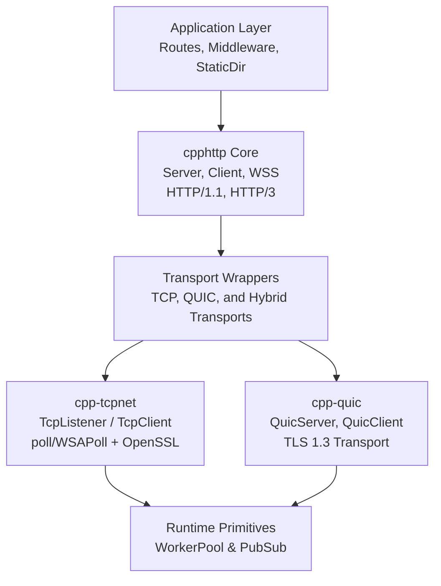
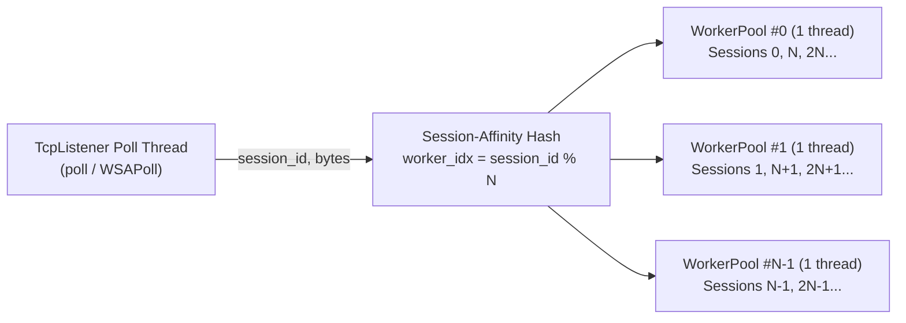
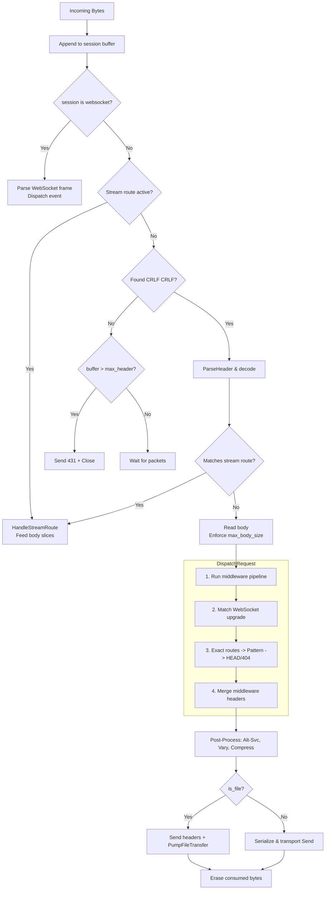
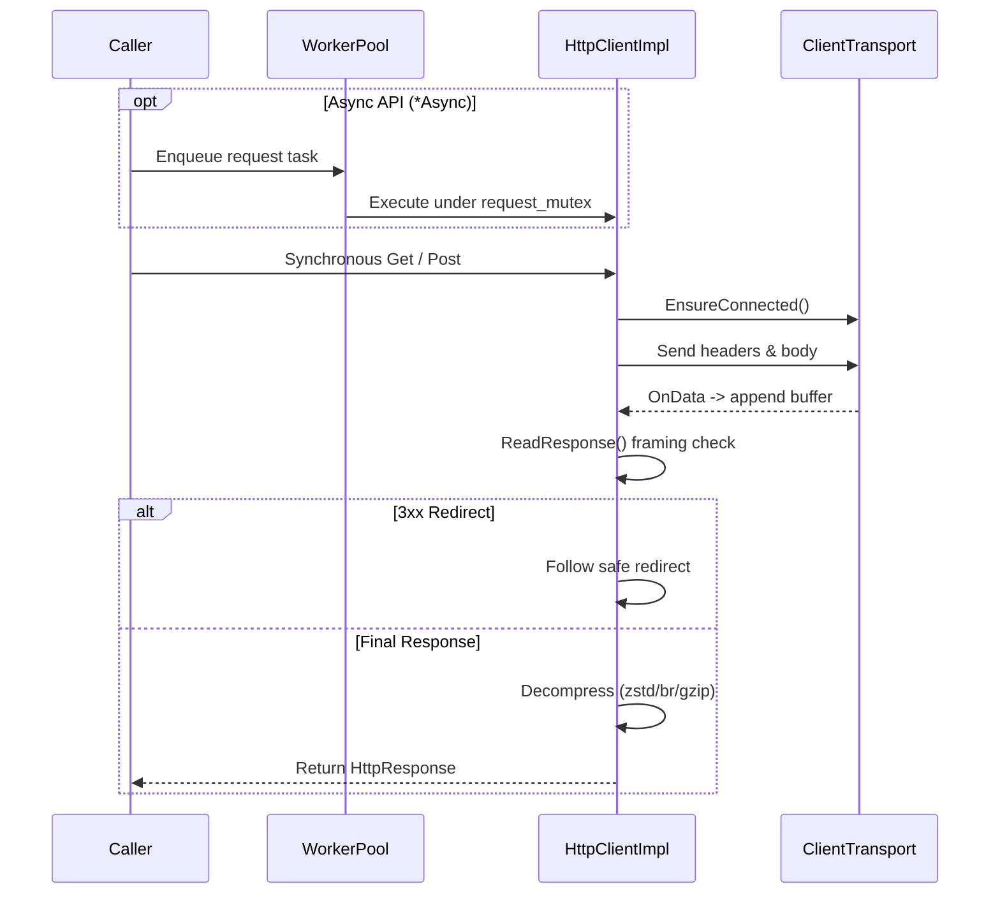

# Architecture & Examples

`cpp-http` is a protocol layer built over a modular, asynchronous C++17 networking stack. It separates socket/QUIC I/O, thread scheduling, event publication, and HTTP/1.1, HTTP/3, and WebSocket protocol handling into cleanly layered components.

## Table of Contents

- [Layered Stack Overview](#layered-stack-overview)
- [Transport Layers (`cpp-tcpnet` and `cpp-quic`)](#transport-layers-cpp-tcpnet-and-cpp-quic)
- [Event Loop and Background Pump](#event-loop-and-background-pump)
- [Session-Affinity Worker Pool](#session-affinity-worker-pool)
- [Server Request Lifecycle](#server-request-lifecycle)
- [Client Internals](#client-internals)
- [Examples Walkthrough](#examples-walkthrough)

---

## Layered Stack Overview

At compile time, `HttpServerImpl<Transport>` and `HttpClientImpl<Transport>` bind to either TCP (`cpp-tcpnet`) or QUIC/UDP (`cpp-quic`), or to `HybridServerTransport` to serve both simultaneously.



---

## Transport Layers (`cpp-tcpnet` and `cpp-quic`)

All protocol classes delegate socket and datagram I/O to thin transport adapters in `cpphttp.hpp`:

| Adapter | Underlying Engine | Responsibilities |
| :--- | :--- | :--- |
| `TcpServerTransport` | `cpptcpnet::TcpListener` | Non-blocking TCP accept/read/write, optional OpenSSL/LibreSSL TLS, `ConnectionProfile` tuning, `state_events` & `transfer_events` subscriptions |
| `TcpClientTransport` | `cpptcpnet::TcpClient` + `cpppubsub::Worker` | Outbound TCP/TLS connect with `ClientTlsConfig`, asynchronous read callbacks, disconnect signaling, `transfer_events` subscriber |
| `QuicServerTransport` | `cppquic::QuicServer` | UDP/QUIC stream handling, auto-detection of HTTP/3 (`HEADERS`/`DATA`/`SETTINGS` + QPACK) vs raw HTTP/1.1-over-QUIC, maps `(conn_id, stream_id)` to `session_id` |
| `QuicClientTransport` | `cppquic::QuicClient` | Opens bidirectional QUIC streams per request (`OpenStream(true)`), decodes HTTP/3 `HEADERS`/`DATA` frames back into HTTP/1.1 responses for `HttpClientImpl` |
| `HybridServerTransport` | `TcpServerTransport` + `QuicServerTransport` | Binds TCP and UDP to the same port, maps `(is_quic, transport_session_id)` to unified `uint64_t` session IDs so one `HttpServerImpl` serves both protocols |

### How HTTP/3 Translation Works

`HttpServerImpl` speaks HTTP/1.1 internally, while `QuicServerTransport` acts as a bidirectional protocol bridge:

1. **Inbound (`HandleQuicStreamData`):** Inspects the first byte of stream data (`data[0] < 0x20` indicates HTTP/3 unidirectional/framed streams). For HTTP/3 connections, it opens the server's control (`0x00` + `SETTINGS`) and QPACK encoder/decoder (`0x02`, `0x03`) unidirectional streams, decodes client `HEADERS` frames (`0x01`) via `cpphttp::qpack::Decode`, buffers `DATA` frames (`0x00`) up to `max_body_size_`, and calls `http3::ReconstructHttp11Request` on stream `FIN`.
2. **Outbound (`Send` / `ProcessResponseBytes`):** Incrementally parses the HTTP/1.1 response generated by `HttpServerImpl` (including `Content-Length`, `Transfer-Encoding: chunked`, and file stream chunks), strips connection-specific headers (`Connection`, `Keep-Alive`, `Proxy-Connection`, `Transfer-Encoding`, `Upgrade`), encodes a `HEADERS` frame (`0x01`) with `qpack::Encode`, wraps body pieces in `DATA` frames (`0x00`), and sends stream `FIN` once the full body is written.

> **Note:** `QuicServerTransport` enforces `kMaxH3FrameSize` (`64 KB`) for control and header frames and `max_body_size_` (default `10 MB`) for request `DATA` frames. Protocol violations or malformed pseudo-headers close the QUIC connection immediately.

---

## Event Loop and Background Pump

`HttpServerImpl` coordinates network I/O and asynchronous transfers using two complementary execution contexts:

1. **Transport I/O & Worker Threads (`cpptcpnet` / `cppquic`):**
   - `TcpListener` runs an OS poller thread (`poll` on Linux/macOS, `WSAPoll` on Windows) that accepts sockets, performs non-blocking reads/writes and TLS handshakes, and publishes `ConnectionEvent` and `TransferEvent` messages via `cpppubsub::PubSub` (reached via `GetEventBroker()`).
   - `QuicServer` runs its UDP packet loop, encryption, and stream state machine over `cppudpnet` and `cppquic`'s worker pool.
2. **Server Event Pump (`HttpServerImpl::background_thread_`):**
   Started by `server.Start()` and joined cleanly by `server.Stop()`, `background_thread_` drains `transport_->TryReceiveTransferEvent()` and `transport_->TryReceiveConnectionEvent()` in a loop, waiting on `shutdown_cv_` for `idle_timeout_` (default `10ms`) whenever both queues are empty:
   - **Send completion & graceful close:** When `event->is_send` arrives for a session in `sessions_to_close_`, it decrements `pending_send_bytes_[session_id]` and calls `transport_->Disconnect(session_id)` only after every response byte has been handed off to the socket.
   - **Chunked file streaming (`PumpFileTransfer`):** Decrements `session->file_bytes_in_flight` and pumps the next disk chunk (compressing on the fly via `StreamCompressor` when `is_compressed_stream` is active) while keeping in-flight bytes under `max_outbound_buffer_size / 2` (minimum `64 KB`).
   - **Disconnect cleanup:** On `ConnectionState::Disconnected`, removes the `SessionState` from `sessions_`, invokes `ws_behavior.on_close` for upgraded WebSockets, and clears pending close tracking.

---

## Session-Affinity Worker Pool

In `TcpListener`, incoming socket bytes are not processed on the OS poll thread. Instead, `TcpListener` creates `N` independent single-threaded `cppasyncworker::WorkerPool(1)` workers (defaulting to `std::thread::hardware_concurrency()`, configurable via `server.GetListener().SetWorkerThreadCount(N)`).



Because each `session_id` always maps to the same single-threaded worker:
- Byte chunks for a single TCP connection arrive at `HandleIncomingData` **strictly in order**, preventing race conditions in header reassembly, HTTP pipelining, and WebSocket frame decoding.
- Different connections execute **in parallel** across all CPU cores without a global parser lock.

> **Tip:** Route callbacks run directly on these worker threads. Per-connection parsing is serialized automatically, but any shared application state (maps, counters, databases) accessed across routes must still be protected with `std::mutex` or `std::atomic`.

---

## Server Request Lifecycle

Every packet delivered to `HttpServerImpl::HandleIncomingData` moves through the pipeline below:



> **Note:** Notice in the lifecycle above that `PostStream` / `PutStream` routes are matched immediately after `ParseHeader` so upload chunks stream without buffering the body, which means they bypass `middlewares_`.

---

## Client Internals

### `HttpClientImpl<Transport>`

`HttpClientImpl` provides synchronous, asynchronous (`*Async`), streaming download (`GetStream` / `PostStream`), and streaming upload (`PostStreamAsync` / `PutStreamAsync`) APIs over a persistent keep-alive connection:



Key internal behaviors:
- **Thread safety & shutdown:** `request_mutex_` serializes concurrent requests on one client instance. `*Async` calls share a global `cppasyncworker::WorkerPool` (default is `std::thread::hardware_concurrency()`, falling back to 4 when that is ≤ 1; must be set via `SetClientWorkerPoolSize` before constructing the first client using the default pool, because the pool is a function-local static) or an injected pool, and `~HttpClientImpl()` sets `alive_ = false` and waits for all `pending_tasks_` before tearing down the transport.
- **Keep-alive & error recovery:** Connections stay open across requests unless the server sends `Connection: close`, an error/timeout occurs, or the client redirects to a different origin.

### `WebSocketClient`

`WebSocketClient` wraps `cpptcpnet::TcpClient` and a `cpppubsub::Worker` for connection-state events:
- On `Connect(url, timeout)`, parses `ws://` or `wss://`, configures OpenSSL via `ClientTlsConfig` (peer verification enabled by default), generates a random 16-byte `Sec-WebSocket-Key`, and verifies the server's `101 Switching Protocols` + `Sec-WebSocket-Accept` response.
- All outbound frames sent by `Send`, `SendBinary`, `Ping`, and `Close` are masked with a per-frame random 4-byte key as required by RFC 6455.
- Inbound frames are assembled in `ProcessFrames()` (supporting continuation frames up to `max_body_size_` = `10 MB`, auto-replying `Pong` to `Ping`, and dispatching `OnMessage`/`OnBinary`/`OnClose`).
- Uses `internal::CallbackScope` and `StopClientAndWorker` so calling `Disconnect()` or `Close()` from inside an `OnMessage`/`OnClose` callback defers thread joining and avoids self-deadlock.

---

## Examples Walkthrough

All example programs live in `examples/` and are configured in `CMakeLists.txt` under `CPPHTTP_BUILD_EXAMPLES` (enabled by default when `cpp-http` is the top-level CMake project).

### Building All Examples

```bash
cmake -B build
cmake --build build -j
```

To build without QUIC/HTTP3 targets:

```bash
cmake -B build -DCPPHTTP_ENABLE_QUIC=OFF
cmake --build build -j
```

### Summary of Example Targets

| Target Name | Requirements & Port | Primary Features Shown |
| :--- | :--- | :--- |
| [`spa_example`](https://github.com/jonoton/cpp-http/blob/main/examples/spa_example.cpp) | Port `8085` (TCP) | `StaticDir` SPA mode, scoped auth, cookie sessions, JSON API |
| [`download_example`](https://github.com/jonoton/cpp-http/blob/main/examples/download_example.cpp) | Port `8086` (TCP) | Async file streaming, compression benchmarks, header rewrites |
| [`websocket_example`](https://github.com/jonoton/cpp-http/blob/main/examples/websocket_example.cpp) | Port `8087` (TLS) | HTTPS (`EnableSSL`), WebSocket (`wss://`) echo, Web UI |
| [`quic_http_server`](https://github.com/jonoton/cpp-http/blob/main/examples/quic_http_server.cpp) | Port `4433` (QUIC) | `HybridHttpServer` (HTTPS + HTTP/3), server statistics |
| [`quic_http_client`](https://github.com/jonoton/cpp-http/blob/main/examples/quic_http_client.cpp) | QUIC CLI | `HttpClientImpl<QuicClientTransport>`, logging, file output |
| [`protocol_throughput_benchmark`](https://github.com/jonoton/cpp-http/blob/main/examples/protocol_throughput_benchmark.cpp) | Port `8080` (QUIC) | 20 MB throughput comparison: HTTPS vs HTTP/3 vs WSS |

---

### 1. `examples/spa_example.cpp` (`spa_example`)

Demonstrates a full Single Page Application backend with cookie-based authentication:
- Generates a temporary `./demo_spa_dist/` directory with `index.html` and `static/css/style.css`, then mounts it at `/app` via `server.StaticDir("/app", spa_dir, true)` (SPA fallback enabled).
- Registers scoped middleware `server.Use("/api/", ...)` that checks `Cookie: session_token=...` against a mutex-guarded `active_sessions` set (allowing `/api/login` and `/api/me` through, returning `401` JSON otherwise).
- Implements `/api/login`, `/api/logout`, `/api/me`, and `/api/dashboard-data`, setting `HttpOnly; SameSite=Strict` cookies via `Set-Cookie`.

Run it:

```bash
./build/spa_example
# Open http://localhost:8085/app/ in browser (admin / password123)
```

---

### 2. `examples/download_example.cpp` (`download_example`)

Demonstrates memory-efficient static file streaming and live compression benchmarking:
- Generates `index.html` plus `small_file.txt` (10 KB), `medium_file.txt` (5 MB), and `large_file.txt` (25 MB) inside `./demo_download_dist/` and serves them via `server.StaticDir("/", demo_dir, false)`.
- Registers a global middleware (`server.Use(...)`) that copies a custom `X-Accept-Encoding` header into `req.headers["Accept-Encoding"]`, allowing the browser UI's `fetch()` speed tests to compare compressed (`gzip, br, zstd`) vs uncompressed (`identity`) transfers side-by-side.

Run it:

```bash
./build/download_example
# Open http://localhost:8086/ in your browser
```

---

### 3. `examples/websocket_example.cpp` (`websocket_example`)

Demonstrates HTTPS and secure WebSocket (`wss://`) communication:
- Loads `certs/server.crt` and `certs/server.key` (using `CPPHTTP_CERTS_DIR` injected by CMake) and enables TLS via `server.GetListener().EnableSSL(ssl_config)`.
- Serves an interactive chat UI on `GET /` and registers a WebSocket echo handler on `server.WebSocket("/ws", std::move(ws_behavior))` implementing `on_open`, `on_message`, and `on_close`.

Run it:

```bash
./build/websocket_example
# Open https://localhost:8087/ in browser (accept self-signed cert)
```

---

### 4. `examples/quic_http_server.cpp` (`quic_http_server`)

Demonstrates `cpphttp::HybridHttpServer` serving both HTTPS (TCP) and HTTP/3 (UDP/QUIC) on the same port:
- Attaches `cppquic::SetLogger` for QUIC diagnostics.
- Configures `certs/server.crt` and `certs/server.key` on **both** `server.GetTransport()->GetTcpTransport().GetListener().EnableSSL(ssl_config)` and `server.GetTransport()->GetQuicTransport().GetServer().SetCertificate(cert_file, key_file)`.
- Serves `/`, `/about`, and `/api/stats` (reading live counters from `server.GetTransport()->GetServer().GetStats()`, including `active_connections`, `packets_sent`, `streams_opened`, and `retransmissions`).

Run it:

```bash
./build/quic_http_server 4433 0.0.0.0
# Open https://localhost:4433/ in Chrome/Edge or test with curl --http3
```

---

### 5. `examples/quic_http_client.cpp` (`quic_http_client`)

Demonstrates querying a QUIC/HTTP/3 server from C++ with `HttpClientImpl<QuicClientTransport>`:
- Accepts optional CLI arguments: `host` (`127.0.0.1`), `port` (`4433`), `path` (`/`), and `save_filename` (`index.html`).
- Sets a 5-second timeout (`SetTimeout`), attaches `cppquic::SetLogger`, sends `client.Get(path, headers)`, prints response headers, and either prints JSON bodies or saves HTML to `save_filename`.

Verify the server with `curl` (main check with HTTP/3 support):

```bash
curl --http3-only -k https://127.0.0.1:4433/api/stats
```

> **Warning:** Running `./build/quic_http_client 127.0.0.1 4433 /api/stats` directly against `quic_http_server` fails TLS verification. `quic_http_server` serves a self-signed certificate (`server.crt`), and `quic_http_client.cpp` does not relax verification (`ClientTlsConfig::verify_peer` defaults to `true`). To connect with `quic_http_client`, update `examples/quic_http_client.cpp` to specify the CA file (`ca_file`) or allow self-signed certificates via `client.SetAllowSelfSigned(true);`.

---

### 6. `examples/protocol_throughput_benchmark.cpp` (`protocol_throughput_benchmark`)

Benchmarks a 20 MB transfer across all three protocols against an in-process `HybridHttpServer`:
- Configures `SetMaxBodySize(40 MB)`, `SetMaxOutboundBufferSize(40 MB)`, `SetSendChunkSize(128 KB)`, `cppquic::QuicProfile::HighThroughput()`, and TLS certificates for both TCP and QUIC.
- Measures and prints throughput (`MB/s`) for:
  1. **HTTP/1.1 over TLS (`HttpClient`):** `GET /download` with `ClientTlsConfig::ca_file`.
  2. **HTTP/3 over QUIC (`HttpClientImpl<QuicClientTransport>`):** Initial handshake pass + warm-connection reuse pass on `GET /download`.
  3. **Secure WebSocket (`WebSocketClient`):** Echoes 256 KB chunks over `wss://` until 20 MB is echoed back, reporting combined send+receive throughput.

Run it:

```bash
./build/protocol_throughput_benchmark 8080
```

---

<div class="page-nav">
  <a href="./advanced-usage.html" class="page-nav-link">
    <span class="page-nav-subtitle">Previous Section</span>
    <span class="page-nav-title">&larr; Advanced Usage</span>
  </a>
  <a href="./performance-metrics.html" class="page-nav-link page-nav-next">
    <span class="page-nav-subtitle">Next Section</span>
    <span class="page-nav-title">Performance & Tuning &rarr;</span>
  </a>
</div>
